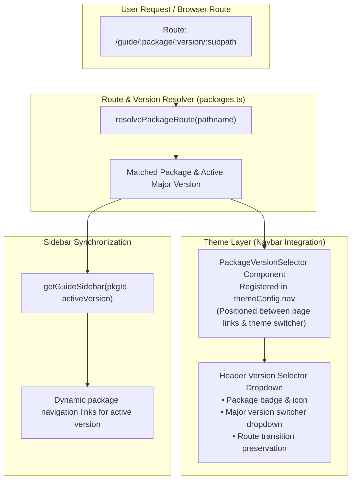

# Multi-Package Versioning & Documentation Architecture

This document describes the multi-package versioning architecture and custom Vue component designed for the React Native Neutralinojs documentation site.

---

## Motivation & Architecture Goals

In this monorepo, each package follows independent SemVer release lifecycles:

- **`react-native-neutralinojs`**: Core CLI, bundler plugin, and runtime engine (current major: `v2`).
- **`@react-native-neutralinojs/new-app-screen`**: Standalone desktop UI and template screens (current major: `v1`).

Because VitePress does not include native multi-package version selector plugins, this repository implements a custom architecture separating documentation exclusively by **major versions** (`v<Major>`) while sharing global getting-started guides.

---

## Architectural Workflow



---

## Directory Structure

Versioned guides are organized hierarchically under `docs/guide/`:

```text
docs/guide/
├── getting-started.md                 # Shared: Prerequisites & workflow overview
├── installation.md                    # Shared: Monorepo installation guide
├── react-native-neutralinojs/         # Core library package
│   └── v2/                            # Current major: v2
│       ├── index.md                   # v2 Overview & feature matrix
│       ├── cli-commands.md            # CLI commands reference
│       ├── configuration.md           # Configuration schemas
│       └── troubleshooting.md         # Diagnostic & troubleshooting guide
└── new-app-screen/                    # Standalone desktop UI package
    └── v1/                            # Current major: v1
        └── index.md                   # Desktop UI guide & alias setup
```

---

## Adding New Major Versions

When introducing a new major version (e.g. `v3` for `react-native-neutralinojs`):

1. **Create the version directory**:

   ```bash
   mkdir docs/guide/react-native-neutralinojs/v3
   cp -r docs/guide/react-native-neutralinojs/v2/* docs/guide/react-native-neutralinojs/v3/
   ```

2. **Register the version in `docs/.vitepress/packages.ts`**:

   ```typescript
   'react-native-neutralinojs': {
     id: 'react-native-neutralinojs',
     name: 'react-native-neutralinojs',
     displayName: 'react-native-neutralinojs',
     defaultVersion: 'v3',
     versions: [
       { version: 'v3', label: 'v3 (latest)', isLatest: true, path: '/guide/react-native-neutralinojs/v3/' },
       { version: 'v2', label: 'v2', isLatest: false, path: '/guide/react-native-neutralinojs/v2/' },
     ],
     sidebarItems: {
       v3: [ ... ],
       v2: [ ... ],
     }
   }
   ```

3. **Register the route prefix in `docs/.vitepress/config.mts`**:
   ```typescript
   '/guide/react-native-neutralinojs/v3/': getGuideSidebar('react-native-neutralinojs', 'v3'),
   ```

The version selector component and sidebar will immediately recognize the new version with zero additional plugins.
